## Mini-projet 1 : Déployer une application web à deux niveaux avec Kubernetes (k3s)
1. Présentation du mini-projet
2. Module : Orchestration de conteneurs avec Kubernetes (k3s)
Objectif : Déployer une application web composée d'un frontend et d'une API, en utilisant des manifestes YAML versionnés dans un dépôt Git.
Le projet consiste à :
- Déployer une API avec 3 réplicas.
- Déployer un frontend avec 2 réplicas.
- Créer deux Services de type ClusterIP.
- Tester la communication interne par DNS.
- Exposer les deux applications avec Ingress et Traefik.
- Effectuer une mise à jour sans interruption et un rollback.
- Diagnostiquer et corriger une panne volontaire.
2. Architecture de l'application

L'application est composée de deux briques : le frontend, accessible à l'utilisateur, et l'API, qui fournit les données.

                     Utilisateur
                          |
                     Ingress Traefik
                    /               \
          web.k3s.local           api.k3s.local
                |                       |
          frontend-svc                api-svc
           ClusterIP                 ClusterIP
                |                       |
          Deployment                 Deployment
           frontend                     api
          2 réplicas                3 réplicas
                \                       /
                 Communication DNS
Le frontend communique avec l'API en utilisant le nom DNS de son Service. Les Services assurent la communication interne, tandis que l'Ingress permet l'accès depuis l'extérieur du cluster.
## Étape 0 : Préparer le terrain
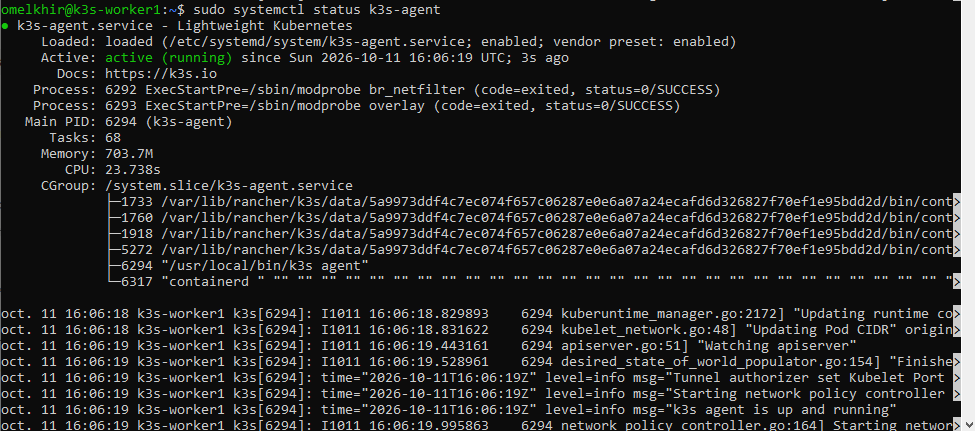
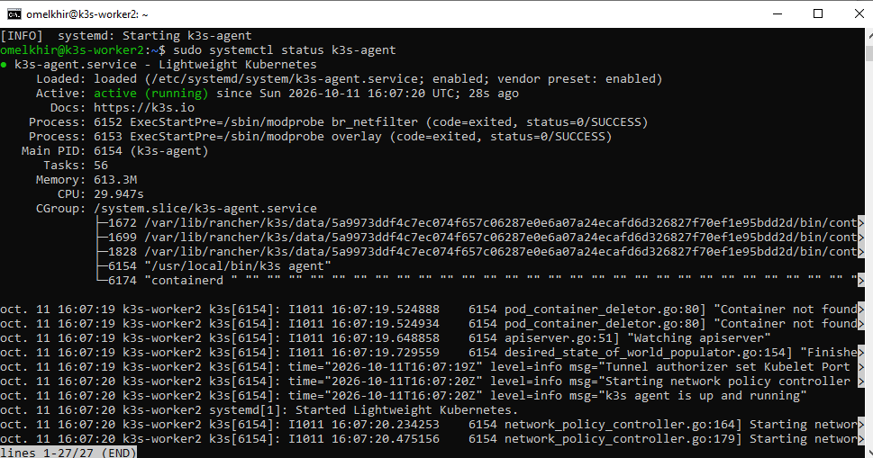
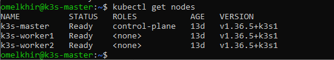
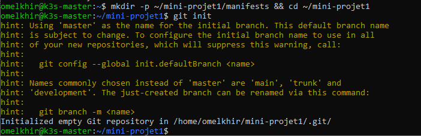
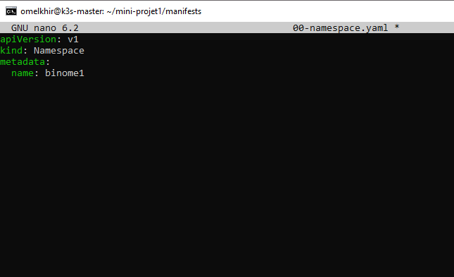
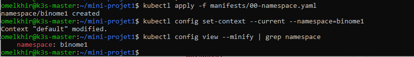
## Étape 1 : Déployer l'API
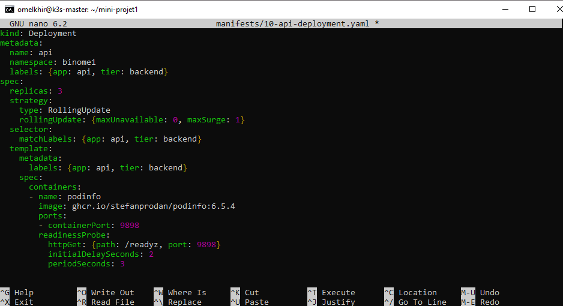
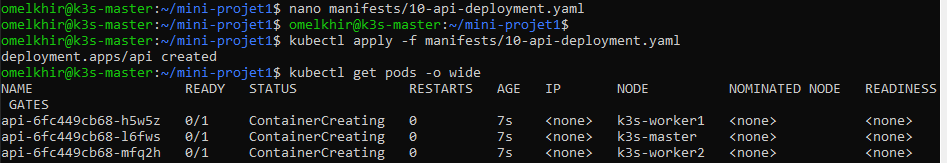
## Étape 2 : Déployer le frontend
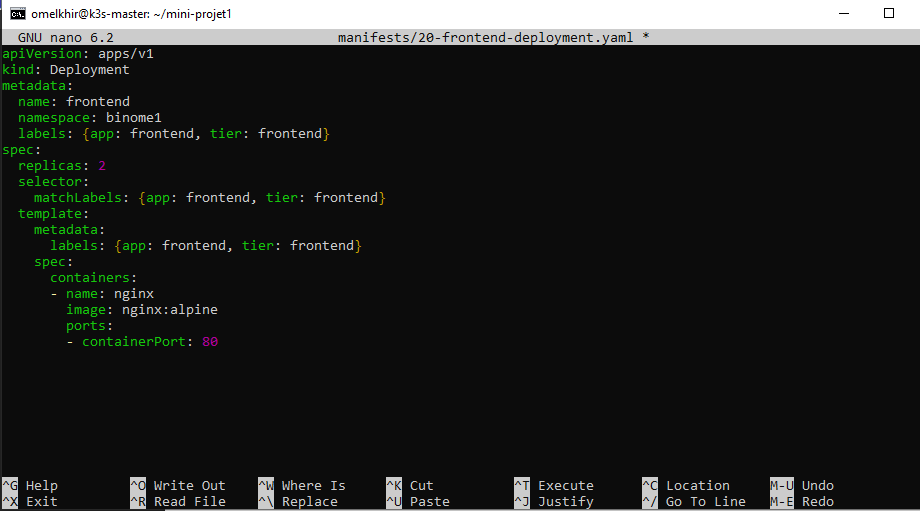
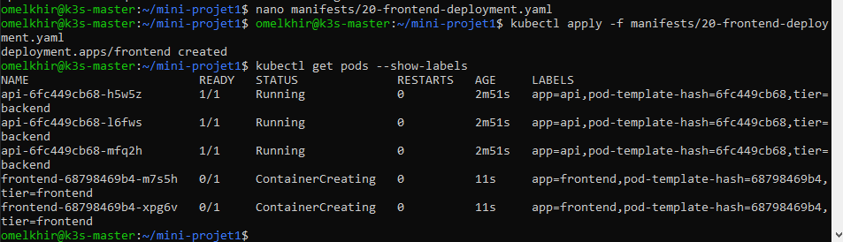
## Étape 3 : Créer les Services et tester la communication interne
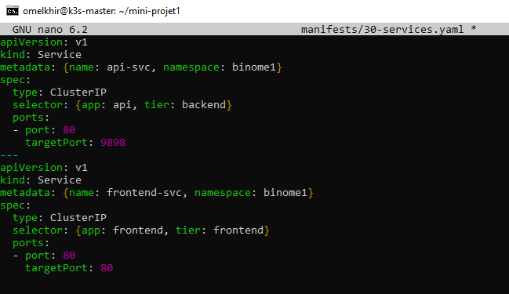
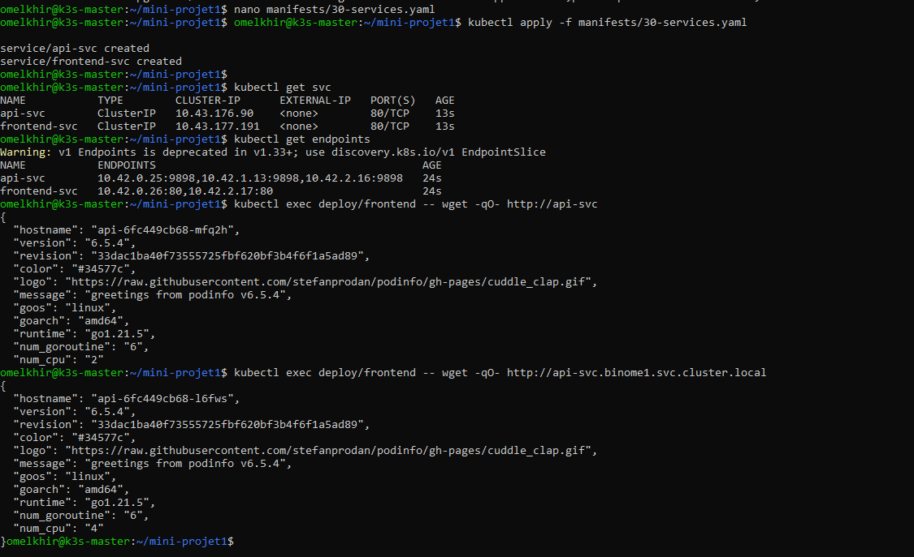
## Étape 4 : Exposer les applications avec Ingress
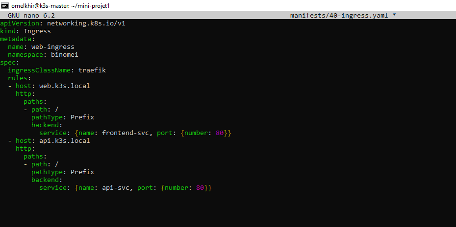
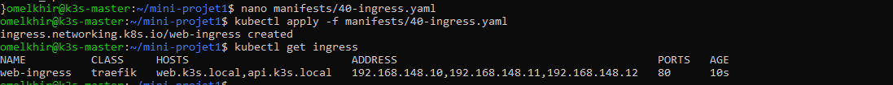
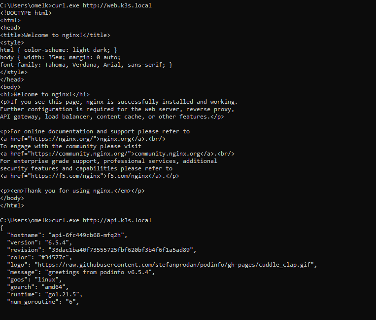
## Étape 5 : Mise à jour sans interruption
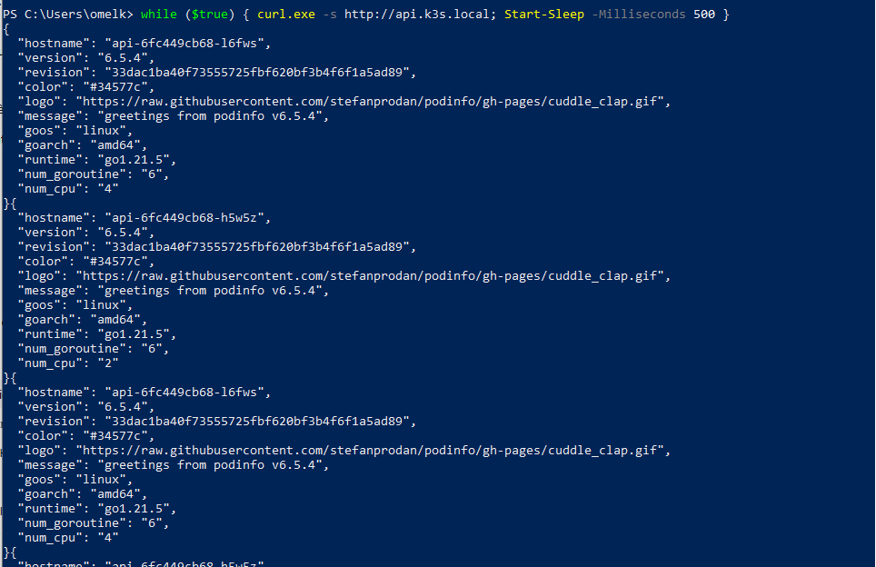
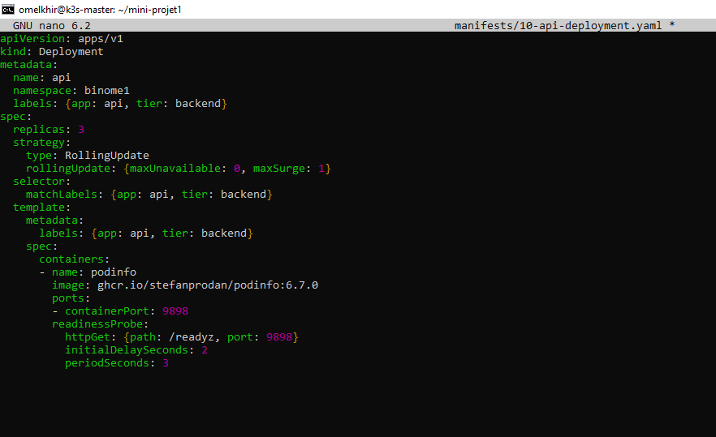
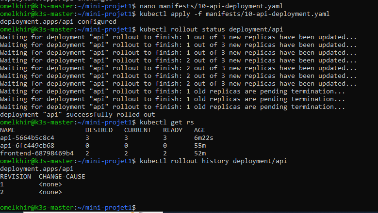
## Étape 6 : Panne et diagnostic
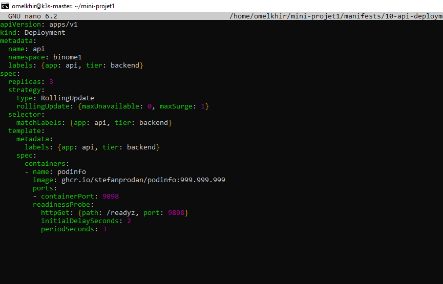
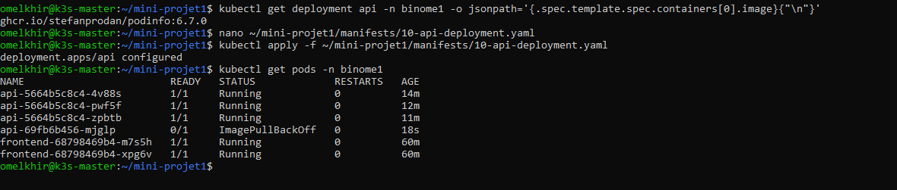
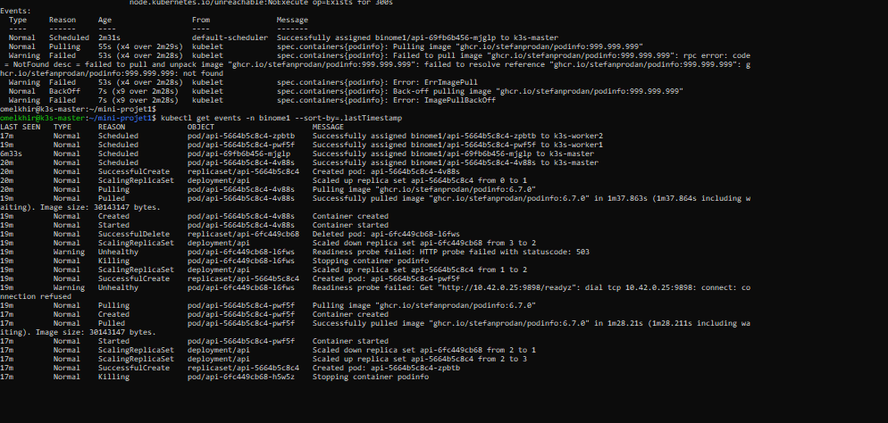
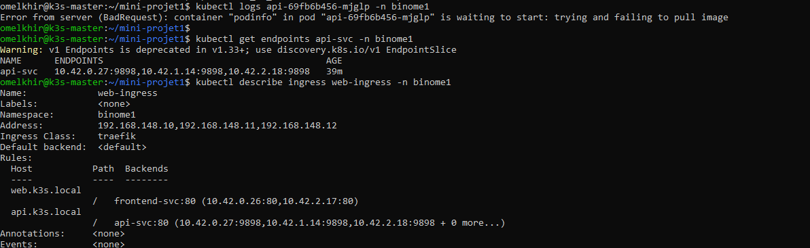
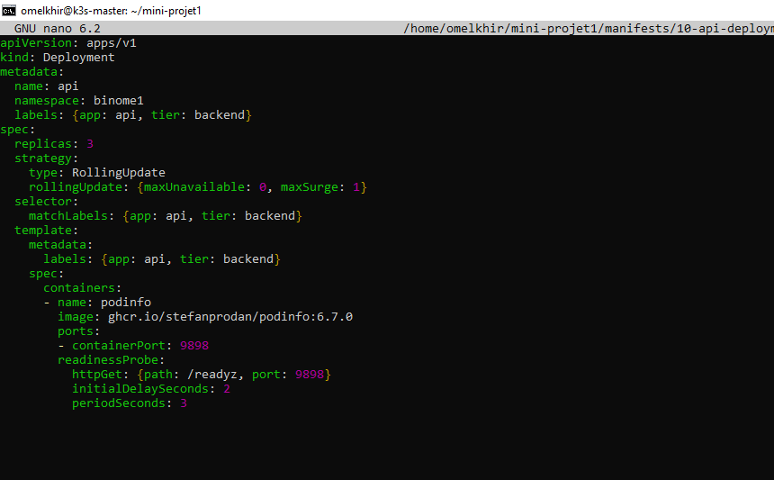
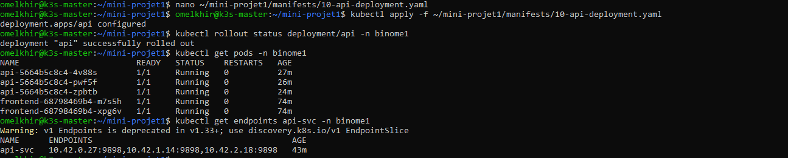
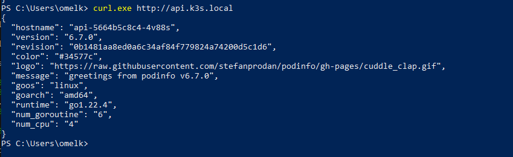
